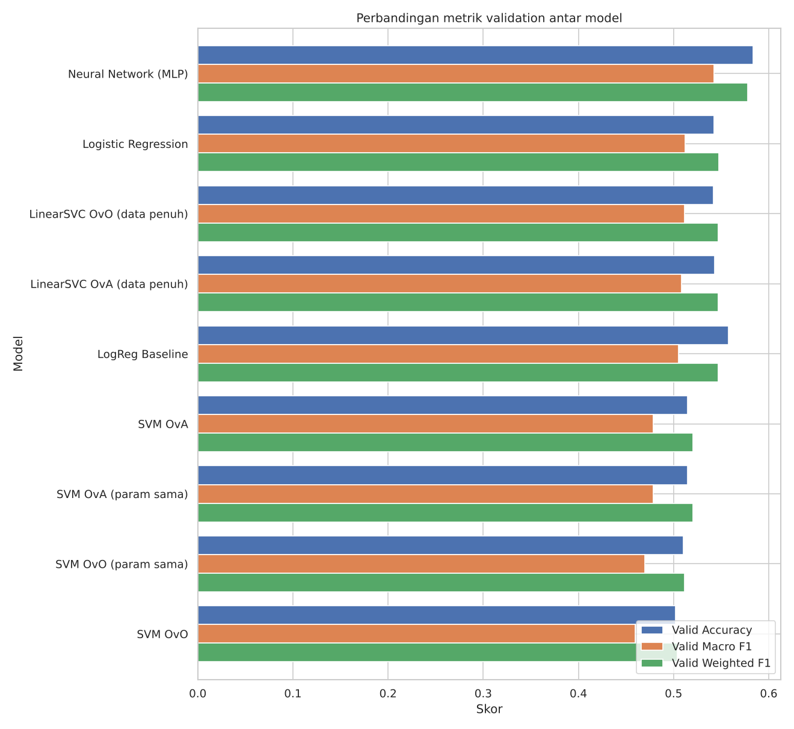
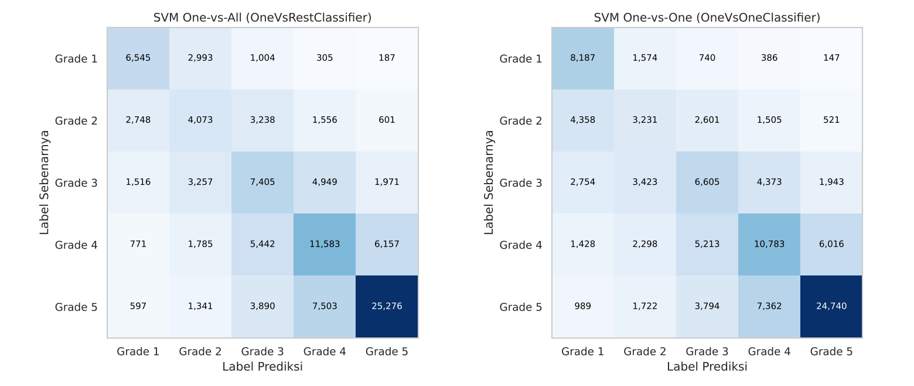

# Structural Damage Classification

Perbandingan model klasifikasi multikelas (Logistic Regression, SVM One-vs-All vs One-vs-One, dan Neural Network) untuk memprediksi tingkat kerusakan bangunan (`damage_grade`) pada kompetisi Kaggle **Structural Damage Classification**.

## Daftar Isi

1. [Deskripsi Proyek](#deskripsi-proyek)
2. [Dataset](#dataset)
3. [Struktur Repository](#struktur-repository)
4. [Workflow Analisis](#workflow-analisis)
5. [Model yang Dibandingkan](#model-yang-dibandingkan)
6. [Cara Menjalankan](#cara-menjalankan)
7. [Hasil Eksperimen](#hasil-eksperimen)
8. [Interpretasi Hasil](#interpretasi-hasil)
9. [Submission Kaggle](#submission-kaggle)
10. [Keterbatasan dan Pengembangan](#keterbatasan-dan-pengembangan)
11. [Lisensi](#lisensi)

## Deskripsi Proyek

Setiap bangunan dalam dataset dinilai dengan salah satu dari lima tingkat kerusakan (`Grade 1` sampai `Grade 5`) berdasarkan karakteristik struktur dan lokasinya. Proyek ini:

- melakukan EDA terhadap data asli kompetisi,
- membangun preprocessing yang bebas *data leakage* dengan `Pipeline` dan `ColumnTransformer`,
- membandingkan Logistic Regression, SVM yang dibungkus **One-vs-All** (`OneVsRestClassifier`) dan **One-vs-One** (`OneVsOneClassifier`), serta Neural Network (MLP, TensorFlow/Keras),
- memilih model final berdasarkan **Macro F1**, karena kelima kelas dianggap sama penting dan distribusinya tidak seimbang,
- membuat `submission.csv` dengan format yang sama seperti `sample_submission.csv`.

Seluruh analisis berada dalam satu notebook: [`notebooks/structural_damage_classification_v2.ipynb`](notebooks/structural_damage_classification_v2.ipynb).

## Dataset

**Sumber:** https://www.kaggle.com/competitions/structural-damage-classification/data

Dataset **tidak disertakan** dalam repository ini karena mengikuti aturan kompetisi Kaggle dan ukuran filenya besar (train ±97 MB). Unduh dataset langsung dari Kaggle.

| File | Isi |
|---|---|
| `train.csv` | 533.465 baris, `building_id`, 15 fitur, dan target `damage_grade` |
| `test.csv` | 228.629 baris, `building_id` dan 15 fitur (tanpa target) |
| `sample_submission.csv` | Contoh format submission: `building_id,damage_grade` |
| `metadata.csv` | Kamus data |

Catatan struktur data hasil pemeriksaan:

- Label target berupa teks `"Grade 1"` … `"Grade 5"`. Notebook memetakannya ke angka 1–5 untuk pemodelan, lalu mengembalikannya ke teks asli saat membuat submission.
- `metadata.csv` mendeskripsikan 11 kolom biner `has_superstructure_*`, tetapi file train/test menyimpannya sebagai **satu kolom kategorikal `superstructure`**.
- `district_id`, `vdcmun_id`, dan `ward_id` adalah kode wilayah, sehingga diperlakukan sebagai fitur kategorikal.
- Tidak ada missing value eksplisit. Namun, `age_building = 999` dipakai sebagai kode "tidak diketahui" dan ditangani sebagai missing di dalam pipeline.

## Struktur Repository

```text
structural-damage-classification/
├── README.md               # dokumentasi proyek
├── requirements.txt        # dependensi Python
├── .gitignore              # mengecualikan dataset, output lokal, dan kredensial
├── data/
│   └── raw/
│       └── .gitkeep        # letakkan train.csv, test.csv, dst. di sini (tidak di-commit)
├── notebooks/
│   └── structural_damage_classification_v2.ipynb   # EDA, preprocessing, training, evaluasi, submission
└── reports/
    ├── model_comparison.csv      # ringkasan metrik seluruh model (hasil run notebook)
    ├── ova_vs_ovo_comparison.csv # tabel khusus OvA vs OvO
    └── figures/                  # grafik penting hasil run notebook (confusion matrix, metrik, kurva NN)
```

Saat dijalankan di lokal, notebook otomatis membuat folder `outputs/` (grafik dan tabel) dan `submission/` (`submission.csv`). Kedua folder ini tidak di-commit.

## Workflow Analisis

```mermaid
flowchart LR
    A[Deteksi & load data] --> B[EDA]
    B --> C[Cleaning & pemisahan X / y]
    C --> D[Stratified split 80/20<br/>random_state=123]
    D --> E[Pipeline + ColumnTransformer<br/>fit hanya pada train]
    E --> F[Tuning: Stratified K-Fold<br/>pada data train]
    F --> G[Evaluasi pada validation]
    G --> H[Pemilihan model<br/>Macro F1]
    H --> I[Retrain pada seluruh data berlabel]
    I --> J[Prediksi test & submission.csv]
```



**Preprocessing (di dalam `Pipeline`):**

| Tipe fitur | Langkah |
|---|---|
| Numerik (`count_floors_pre_eq`, `age_building`, `plinth_area_sq_ft`, `height_ft_pre_eq`) | sentinel `999` → NaN → `SimpleImputer(median, add_indicator=True)` → `StandardScaler` |
| Kategorikal (kolom teks, `superstructure`, dan kode wilayah) | `SimpleImputer(most_frequent)` → `OneHotEncoder(handle_unknown="infrequent_if_exist", min_frequency=20)` |

Preprocessing di-fit hanya pada data training (atau pada fold training saat cross-validation), sehingga statistik data validation dan test tidak bocor ke model. Hasil one-hot tetap berbentuk *sparse matrix*. Hanya fitur numerik yang distandardisasi, sehingga matriks tidak perlu diubah menjadi dense.

## Model yang Dibandingkan

| Model | Implementasi | Catatan |
|---|---|---|
| Logistic Regression | `LogisticRegression` (multinomial) | Tuning `C`, `solver`, `class_weight` dengan `GridSearchCV` + `StratifiedKFold(5)` |
| SVM OvA | `OneVsRestClassifier(SVC)` | K = 5 classifier biner |
| SVM OvO | `OneVsOneClassifier(SVC)` | K(K−1)/2 = 10 classifier biner |
| LinearSVC OvA / OvO | `OneVsRestClassifier` / `OneVsOneClassifier(LinearSVC)` | Pembanding SVM linear pada **seluruh** data training |
| Neural Network | MLP TensorFlow/Keras (Dense + BatchNorm + Dropout, softmax) | EarlyStopping dengan validation internal dari data train |

`SVC` berkernel memiliki biaya pelatihan sekitar O(n²)–O(n³). Karena itu, SVC OvA dan OvO dilatih pada **subset stratified yang sama** (20.000 baris, `random_state=123`) dan dievaluasi pada **validation yang sama**. LinearSVC dengan data penuh disertakan untuk menilai apakah pembatasan data ini mengubah kesimpulan.

## Cara Menjalankan

### Opsi A: Kaggle Notebook (direkomendasikan)

1. Buka kompetisi di Kaggle dan setujui aturan kompetisi.
2. Buat notebook baru, lalu **File → Import Notebook** dan pilih `notebooks/structural_damage_classification_v2.ipynb`.
3. **Add Input** → tambahkan data kompetisi *Structural Damage Classification*.
4. (Opsional) Aktifkan GPU di **Settings → Accelerator** untuk mempercepat Neural Network.
5. Jalankan **Run All**. Hasil tersimpan di `/kaggle/working/`, dan `submission.csv` ada di `/kaggle/working/submission.csv`.

### Opsi B: Lokal

```bash
git clone <URL_REPOSITORY>
cd structural-damage-classification
python -m venv .venv
```

Aktifkan virtual environment:

```bash
# Windows
.venv\Scripts\activate
# Linux / macOS
source .venv/bin/activate
```

Instal dependensi:

```bash
pip install -r requirements.txt
pip install notebook   # atau gunakan Jupyter di VS Code
```

Unduh dataset ke `data/raw/` (memerlukan token API Kaggle `kaggle.json` di `~/.kaggle/` atau `C:\Users\<nama>\.kaggle\`; jangan simpan token di repository):

```bash
pip install kaggle
kaggle competitions download -c structural-damage-classification -p data/raw
```

Ekstrak ZIP di folder `data/raw/`, lalu buka dan jalankan notebook dari folder `notebooks/`. Notebook mendeteksi lingkungan secara otomatis:

| | Kaggle | Lokal |
|---|---|---|
| Lokasi data | `/kaggle/input/...` | `<root>/data/` (file dikenali dari kolomnya) |
| Output | `/kaggle/working/outputs/` | `<root>/outputs/` |
| Submission | `/kaggle/working/submission.csv` | `<root>/submission/submission.csv` |

Untuk uji cepat alur kode, ubah `FAST_DEV_RUN = True` pada bagian 2.5. Hasil dari mode ini tidak untuk dilaporkan.

## Hasil Eksperimen

Hasil di bawah ini berasal dari satu kali **Run All** notebook pada data asli kompetisi (CPU 4 core, tanpa GPU; scikit-learn 1.9, TensorFlow 2.21) dengan `random_state=123`. Semua metrik dihitung pada **data validation 20%** (106.693 baris) yang tidak dipakai untuk training maupun tuning. Angka bisa sedikit berbeda di lingkungan lain karena versi library dan jumlah thread. Tabel lengkap tersedia di [`reports/model_comparison.csv`](reports/model_comparison.csv).

| Model | Data latih | CV Macro F1 | Accuracy | **Macro F1** | Weighted F1 | Waktu training |
|---|---:|---:|---:|---:|---:|---:|
| **Neural Network (MLP)** | 384.094 | – ¹ | **0,5837** | **0,5423** | **0,5780** | 209 s |
| Logistic Regression (tuned) | 426.772 | 0,5035 | 0,5424 | 0,5120 | 0,5474 | 66 s |
| LinearSVC OvO (data penuh) | 426.772 | 0,4994 | 0,5420 | 0,5114 | 0,5470 | 29 s |
| LinearSVC OvA (data penuh) | 426.772 | 0,4986 | 0,5430 | 0,5081 | 0,5466 | 84 s |
| SVM OvA (SVC, tuned: RBF, C=1, balanced) | 20.000 ² | 0,4315 | 0,5144 | 0,4788 | 0,5203 | 165 s |
| SVM OvO (SVC, tuned: linear, C=1, balanced) | 20.000 ² | 0,4235 | 0,5019 | 0,4597 | 0,5038 | 44 s |
| SVM OvO (SVC, parameter sama dengan OvA) | 20.000 ² | – | 0,5101 | 0,4698 | 0,5117 | 38 s |
| Logistic Regression (baseline default) | 426.772 | – | 0,5576 | 0,5050 | 0,5471 | 52 s |

¹ NN dituning dengan validation internal (10% dari data train), bukan cross-validation.
² Subset stratified dari data train (`random_state=123`). Evaluasinya tetap pada seluruh data validation.

**F1 per kelas (validation):**

| Kelas | Logistic Regression | SVM OvA | SVM OvO | Neural Network |
|---|---:|---:|---:|---:|
| Grade 1 | 0,6245 | 0,5640 | 0,5695 | 0,6681 |
| Grade 2 | 0,3492 | 0,3174 | 0,2641 | 0,3609 |
| Grade 3 | 0,3965 | 0,3695 | 0,3472 | 0,4349 |
| Grade 4 | 0,4858 | 0,4487 | 0,4301 | 0,5123 |
| Grade 5 | 0,7038 | 0,6944 | 0,6875 | 0,7355 |

**Perbandingan OvA vs OvO (SVC):**

| Skenario | Strategi | Classifier biner | Macro F1 | Accuracy | Training | Prediksi validation |
|---|---|---:|---:|---:|---:|---:|
| Tuning terpisah | OvA (RBF) | 5 | 0,4788 | 0,5144 | 165 s | 417 s |
| Tuning terpisah | OvO (linear) | 10 | 0,4597 | 0,5019 | 44 s | 552 s |
| Parameter sama (RBF, C=1, balanced) | OvA | 5 | 0,4788 | 0,5144 | 165 s | 417 s |
| Parameter sama (RBF, C=1, balanced) | OvO | 10 | 0,4698 | 0,5101 | 38 s | 642 s |





**Model final:** Neural Network (MLP; Dense 256 → 128, BatchNorm, Dropout 0,3, Adam lr=1e-3, batch 1024). Model ini dilatih ulang pada seluruh 533.465 baris berlabel selama 24 epoch, yaitu epoch terbaik EarlyStopping (17) yang diskalakan dengan rasio ukuran data, lalu dipakai untuk membuat `submission.csv`.

## Interpretasi Hasil

1. **Karakteristik data.** Kelas tidak seimbang: Grade 5 mencakup 36,2% data, sedangkan Grade 1 hanya 10,3% (rasio 3,5 : 1). Tidak ada missing value eksplisit maupun duplikat baris. Sebanyak 2.198 bangunan memiliki `age_building = 999`, yang diperlakukan sebagai "tidak diketahui". Setelah one-hot encoding (termasuk 945 kode `ward_id`), jumlah fitur menjadi 1.116, dengan matriks yang sangat sparse.
2. **Preprocessing.** Imputasi, scaling, dan encoding di dalam `Pipeline`/`ColumnTransformer` memastikan statistik hanya dipelajari dari data training. Kategori langka digabung (`min_frequency=20`) agar dimensi tetap terkendali dan kategori baru di test tidak menimbulkan error.
3. **Perbandingan model.** Neural Network unggul di semua metrik utama (Macro F1 0,5423; +0,030 dibanding Logistic Regression). Logistic Regression dan kedua LinearSVC data penuh hampir setara (0,508–0,512). Artinya, model linear apa pun berhenti di batas yang sama, dan keuntungan NN berasal dari kemampuannya memodelkan interaksi non-linear antarfitur.
4. **Model terbaik (Macro F1).** Neural Network juga memiliki Accuracy tertinggi, sehingga pemilihan model tidak bertentangan antara kedua metrik. Dibanding baseline Logistic Regression default, tuning (`class_weight="balanced"`, `C=10`) menaikkan Macro F1 dari 0,505 ke 0,512 meskipun Accuracy turun dari 0,558 ke 0,542. Ini contoh mengapa Accuracy saja tidak cukup.
5. **OvA vs OvO.** Pada tuning terpisah, OvA (0,4788) unggul 0,019 atas OvO (0,4597). Namun, keduanya memilih kernel berbeda, sehingga perbandingan ini belum setara. Dengan parameter SVC yang sama, OvA tetap unggul 0,009 Macro F1. OvO lebih cepat dilatih (10 subproblem kecil berisi dua kelas), tetapi lebih lambat saat prediksi karena memakai lebih banyak model. Pada LinearSVC dengan data penuh, OvO justru sedikit lebih baik (0,5114 vs 0,5081). Jadi, selisih kedua strategi kecil dan bergantung pada model dasarnya. Tidak ada strategi yang unggul secara konsisten.
6. **Confusion matrix.** Kesalahan didominasi kelas **bersebelahan**: pada NN, 28% Grade 4 diprediksi sebagai Grade 5, 15% Grade 5 sebagai Grade 4, dan 28% Grade 2 sebagai Grade 3. Grade 2 adalah kelas tersulit (F1 0,26–0,36 di semua model), sedangkan Grade 5 dan Grade 1 (dua ujung skala) paling mudah dikenali. Pola ini wajar untuk label ordinal yang batasnya ditentukan oleh penilaian surveyor.
7. **Overfitting/underfitting.** Selisih Macro F1 train dan validation sangat kecil untuk Logistic Regression dan LinearSVC (< 0,004), yang menandakan underfitting: kapasitas model linear terbatas. NN memiliki selisih moderat (0,047) dan dikendalikan EarlyStopping. SVC OvA RBF menunjukkan indikasi overfitting (train 0,622 vs valid 0,479) karena hanya dilatih pada 20.000 baris.
8. **Efisiensi komputasi.** LinearSVC OvO paling cepat (29 s) dengan Macro F1 hanya 0,031 di bawah NN. NN membutuhkan waktu sekitar 7 kali lebih lama (209 s di CPU). SVC kernel paling mahal: prediksi pada 106.693 baris validation memerlukan 7–11 menit, padahal hanya dilatih pada 20.000 baris.
9. **Keterbatasan eksperimen.** SVC berkernel tidak dilatih pada data penuh, sehingga performanya mungkin underestimate. LinearSVC data penuh disertakan sebagai pembanding. Tuning NN berupa pencarian manual 4 konfigurasi, dan setiap model dijalankan dengan satu seed.
10. **Rekomendasi.** Gunakan **Neural Network (MLP)** sebagai model final karena memiliki Macro F1, Accuracy, dan Weighted F1 tertinggi dengan biaya komputasi yang masih wajar. Jika dibutuhkan model yang lebih sederhana, lebih cepat, dan mudah diinterpretasi, Logistic Regression dengan `class_weight="balanced"` adalah alternatif terbaik.

## Submission Kaggle

- Format: CSV dengan header tepat `building_id,damage_grade`, satu baris per bangunan pada `test.csv` (228.629 baris).
- Label prediksi berupa teks asli kompetisi (`Grade 1` … `Grade 5`), sama seperti `sample_submission.csv`.
- Notebook memvalidasi header, jumlah baris, keunikan dan urutan `building_id`, nilai kosong, serta himpunan label sebelum menyimpan file.
- Unggah melalui halaman kompetisi (**Submit Prediction**) atau dari tab **Output** notebook Kaggle setelah **Save Version → Save & Run All**.

## Keterbatasan dan Pengembangan

- **Informasi fitur terbatas.** Seluruh model linear berhenti di Macro F1 sekitar 0,51, dan kesalahan didominasi kelas bersebelahan. Fitur yang tersedia tidak cukup untuk membedakan tingkat kerusakan yang berdekatan.
- **Biaya SVC berkernel.** Pelatihan O(n²)–O(n³) membuat SVC tidak praktis pada 426 ribu baris, sehingga dipakai subset 20.000 baris.
- **Satu split dan satu seed.** Variasi antar-seed belum diukur.

Peluang pengembangan:

- Model berbasis pohon (LightGBM/XGBoost/CatBoost) yang umumnya kuat pada data tabular dan kategori berkardinalitas tinggi.
- Memanfaatkan sifat **ordinal** target (misalnya regresi ordinal atau penyesuaian threshold) untuk mengurangi kesalahan antarkelas bersebelahan.
- Target encoding atau embedding untuk `ward_id`/`vdcmun_id`, serta fitur turunan (misalnya rasio tinggi per lantai).
- Aproksimasi kernel (`Nystroem` + `LinearSVC`) agar SVM non-linear dapat dilatih pada data penuh.
- Tuning NN yang lebih luas (Optuna) dan rata-rata hasil dari beberapa seed.

## Lisensi

Kode dan notebook dalam repository ini menggunakan lisensi yang tercantum pada file `LICENSE`. Dataset adalah milik penyelenggara kompetisi Kaggle dan tunduk pada aturan kompetisi, sehingga tidak termasuk dalam lisensi repository ini.
